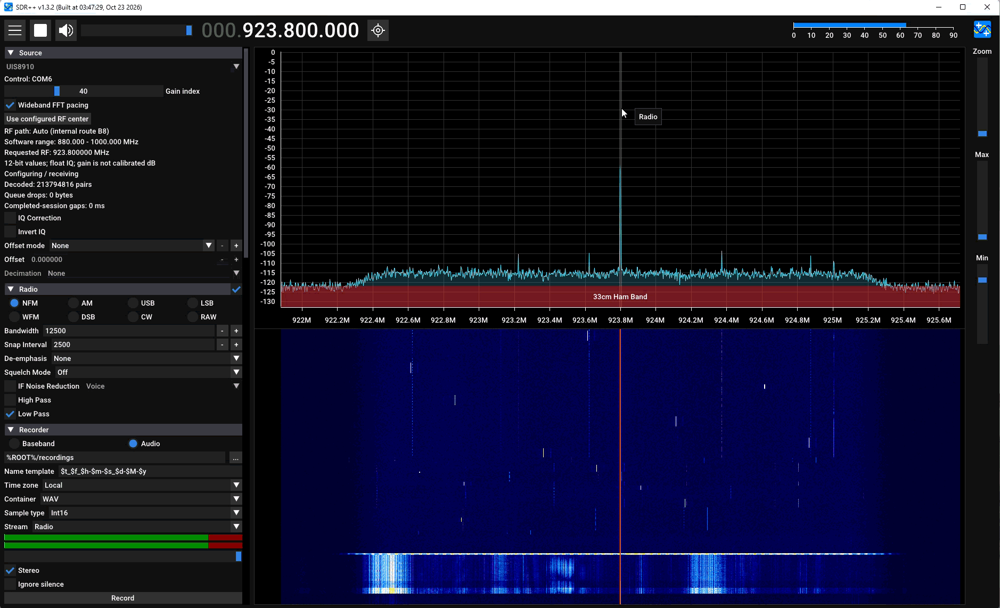
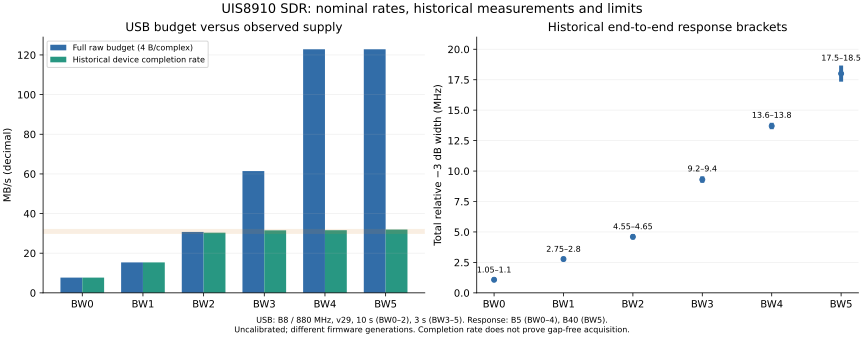

# UIS8910-SDR

**Turning an Air724UG LTE Cat.1 module into a USB raw-IQ receiver.**

[中文说明](README.zh-CN.md) · [Technical report](docs/technical-report.en.md) · [Measured performance](docs/performance.md) · [Getting started](docs/getting-started.md)

This research project exposes the pre-demodulation receive path of the UIS8910DM. It retains vendor boot, RF initialization and board calibration, captures IQ with RXCAPT DMA, and streams raw samples over USB 2.0 High-Speed Bulk IN. Windows software provides a native library/CLI, a SoapySDR driver and an SDR++ source module. No SIM, network registration or LTE decoder is needed.

This is a **receive-only research platform with measured limitations**. Parts of the firmware depend on vendor binaries. The bundled Windows build inputs allow the AP/CP service and PAC to be rebuilt from a downloaded source copy; vendor CP/RF/boot/NV are preserved. Original code and documentation use **GPL-3.0-or-later**; third-party distribution conditions are tracked separately. See [build reproducibility](docs/building.md) and [license scope](LICENSE-STATUS.md).

## Demo



## What works

- One RX channel; frequency, gain index and BW0–BW5 configuration.
- Automatic internal RF routing; SDR applications set a center frequency, without choosing LTE bands.
- Stop → drain → configure → restart without a normal chip reset. Rapid SDR++ frequency changes are coalesced; phase continuity is not promised.
- Native signed12 samples in LE16+16 containers; raw files, binary stdout, Soapy CF32/CS16, and an SDR++ native source.
- Approximately 30–32 MB/s observed device supply/USB baseline. BW0/BW1 fit the data budget; wide modes provide partial output with gaps.
- Ten-second over-air QPSK and OFDM demonstrations with a B210 transmitter and real-time host demodulation.

Current release identities are recorded in the [firmware manifest](outputs/firmware/current/manifest.json) and [host manifest](outputs/host/manifest.json). The release is **v0.1** (byte-identical consolidation of the recorded v32 firmware), CP generation `0x526f0501`. These are historical deployment records, not live device queries.

Build the firmware in Windows from the downloaded source tree:

```powershell
python -m pip install -r requirements/build.txt
python -B tools/build_firmware.py
```

The pinned compiler/SDK subset is included. Output is an unflashed candidate in
`work/build-v0.1/`; [independent-copy build evidence](records/maintenance/release-v0.1-README.md)
and [build scope](docs/building.md) describe the retained vendor components.

Build the Windows host library/CLI and Soapy module in WSL after installing the
[listed Ubuntu dependencies](docs/building-wsl.md):

```bash
python3 -B tools/build_host_components.py --toolchain-root /usr
```

The pinned Soapy source is bundled. Results go to `outputs/host/build-v0.1/`;
this creates candidates without replacing installed components. The native
SDR++ module uses a separate Windows MSVC toolchain.

## Performance at a glance

| Property | Evidence-based description |
| --- | --- |
| RF investigation envelopes | Approximately 687.5–1000 MHz and 1375–2786 MHz; **discrete/grid evidence, not guaranteed continuous coverage** |
| Low-frequency qualification | 687.5 MHz reference success; 970/985 MHz success; 990 MHz condition-dependent; 995/999.9 MHz not qualified. 1000 MHz is a software envelope |
| Upper grid | 2000–2390 MHz: 40/40 points at 10 MHz spacing. 2400–2800 MHz: 72/81 complete references at 5 MHz spacing; conditional points remain marked |
| Format | Two raw lanes, native signed12 in bits15:4 of each LE int16; 4 bytes/complex sample |
| Nominal sample rates | 1.92, 3.84, 7.68, 15.36 and 30.72 Msps; clock accuracy uncalibrated |
| Historical relative −3 dB widths | Approximately 1.05–1.10, 2.75–2.80, 4.55–4.65, 9.2–9.4, 13.6–13.8 and 17.5–18.5 MHz across BW0–BW5 |
| Continuous raw budget | BW0: 7.68 MB/s; BW1: 15.36 MB/s; BW2: 30.72 MB/s with insufficient sustained margin; BW3–BW5 exceed current USB supply |
| Not characterized | ENOB, noise figure, SFDR, IIP3, absolute sensitivity, physical tuning limits, precise sample losses and timestamps |



Measurements use different historical firmware/routes and uncalibrated antennas. Numeric bit width is not ENOB; sample rate is not usable passband; byte equality does not prove continuous acquisition. See [conditions and losses](docs/performance.md).

## Start here

For an already prepared Windows workstation with the recorded firmware and paired host artifacts:

```powershell
python -B tools/sdr.py receive --port COM9 --frequency-hz 2300000000 --gain-index 30 --bandwidth-index 0 --milliseconds 10000 --iq-output work/receive.raw --output work/receive.json
```

`COM9` is an example. Confirm the actual device and release other consumers before opening it. The wrapper writes raw IQ to `--iq-output` and statistics to `--output`. For a fresh checkout, follow [prerequisites and setup](docs/getting-started.md) first. Firmware flashing remains manual.

Raw USB contains only sample bytes: no application header, CRC, content hash, packet ACK or retransmission. USB's own protocol checks still apply. Control and statistics are separate. Gaps and corrupt/lost blocks are accepted and reported where observable.

```python
import numpy as np
lanes = np.fromfile('work/receive.raw', dtype='<i2').reshape(-1, 2)
native12 = lanes >> 4
z = (native12[:, 0].astype(np.float32)
     - 1j * native12[:, 1].astype(np.float32)) / 2048
```

`lane0-j*lane1` is the verified host spectral convention. Physical I/Q labels and absolute phase remain unknown. A raw file has no embedded rate, center frequency or gap positions; keep its control report beside it.

## Engineering documentation

| Topic | Entry |
| --- | --- |
| Conversion method and results | [English technical report](docs/technical-report.en.md) · [中文完整报告](docs/technical-report.md) |
| Data/control/ownership diagrams | [Architecture](docs/architecture.md) |
| Register spaces and PLL reconstruction | [Register reference](docs/register-reference.md) · [129-entry CSV](docs/data/rf-registers.csv) |
| Measurement results and machine-readable tables | [Performance](docs/performance.md) · [Capabilities JSON](docs/data/sdr-capabilities.json) |
| Windows, Soapy and SDR++ | [Getting started](docs/getting-started.md) · [Local Windows handoff](docs/windows-handoff.md) |
| Build and validation boundaries | [Building](docs/building.md) · [Development history](docs/development-history.md) |
| Directory inventory and publication scope | [Project structure](docs/project-structure.md) · [Maintainer review](docs/maintainer-review.md) |
| Sources and rights | [Third-party notices](THIRD_PARTY_NOTICES.md) · [License status](LICENSE-STATUS.md) · [Contributing](CONTRIBUTING.md) |

## Research workspace versus public source

The local workspace contains SDKs, releases, toolchains and frozen history. The [publication procedure](docs/publishing.md) prepares a separate source tree and v0.1 firmware/Windows/Soapy/SDR++ packages. It removes personal paths and device identifiers from copies, excludes IQ, logs and Git history, and preserves component-specific DLL pairings. The [publication manifest](docs/publication-manifest.json) defines the source allowlist. Pinned ARM/SDK inputs and the sole v0.1 platform PAC support firmware builds; their outstanding distribution conditions are recorded in the package report. No upload is performed. Original IQ and generated capture waveforms were removed at the owner's request after preserving final conclusions; small measurement metadata remains for traceability.

```powershell
# Portable documentation/metadata checks; no hardware or SDK required
python -B tools/check_publication.py
# Full retained-workstation identity check; requires local SDK/build artifacts
python -B tools/sdr.py verify
```

Outstanding work is listed in the [maintainer review](docs/maintainer-review.md). Physical RF limits, exact external frontend identity, distribution licensing and Auto boundary consistency remain open. The Windows firmware build is now independently reproduced from the bundled inputs; that does not resolve the remaining hardware questions.
