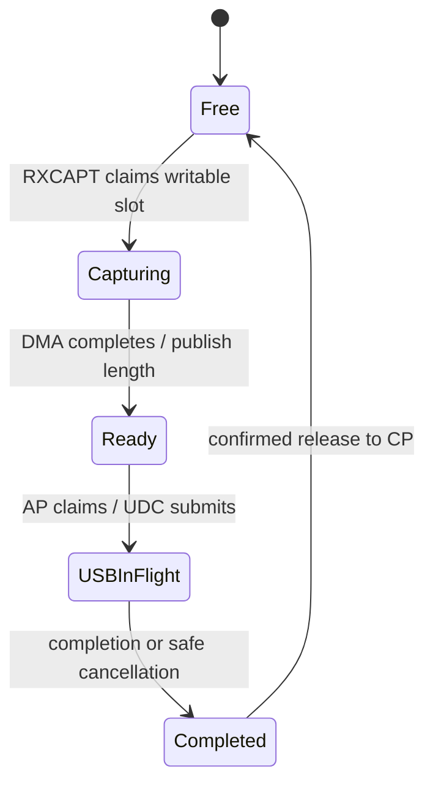

# Architecture / 系统架构

Release v0.1 preserves recorded v32 bytes, CP generation `0x526f0501`. This describes software responsibilities, not an authenticated silicon floorplan. Exact external frontend wiring, core clocks and the complete on-chip memory map are unknown. See the [English report](technical-report.en.md) / [中文报告](technical-report.md).

## Hardware and software responsibilities

```mermaid
flowchart LR
  ANT["Antenna / board frontend"] --> ANA["UIS8910 analog RX"]
  NV["Vendor NV / calibration"] --> INIT["Vendor startup / RF RXON"]
  INIT --> ANA
  INIT -. "RFFE" .-> ANT
  ANA --> DFE["Digital filtering / decimation"]
  DFE --> DMA["RXCAPT DMA"]
  DMA --> DDR["DDR slots / scratch"]
  DDR --> UDC["UDC DMA / Bulk IN"]
  UDC --> WIN["WinUSB async reads"]
  WIN --> FILE["Raw file / stdout"]
  WIN --> ADAPT["Soapy / SDR++ / demodulator"]
  CONTROL["COM control / statistics"] -.-> AP["AP receiver / USB service"]
  AP -. "batched exchange / lease" .-> CP["CP capture service"]
  CP -. "prepare RF" .-> INIT
  CP -. "slot ownership" .-> DDR
  AP -. "submit / complete" .-> UDC
```



- **RF core:** vendor RF instruction image, local MMIO and runtime RAM. Legacy PULP/RISC-V extensions require more than a generic RISC-V decoder. The C reconstruction is a behavioral reference, not a complete startup replacement.
- **CP:** ARM/Thumb capture/control modules invoke RF preparation and manage RXCAPT. NV and board calibration remain required.
- **AP:** boots within the vendor SDK environment, binds CP modules, handles control, submits UDC requests and returns completed buffers. AP/CP mailbox addresses, generation and ABI must match.
- **Windows:** opens independent control and WinUSB interfaces, posts async reads, orders delivery and exposes callbacks. File/plugin consumers use bounded queues and may copy/convert payloads.

## Buffer ownership



These are logical states; enum names differ across modules. A slot cannot be reused merely because a host read was requested. Cache maintenance, DMA visibility, length/alignment, completion and release ordering are necessary. See [USB design](plans/usb-raw-stream.md) and [ownership analysis](../records/usb/current-geometry-supply.json).

Current geometry: six × 8192-byte output slots (49,152 B), plus paired scratch for discarded acquisition. Calculated output-slot time capacity is only 6.4 ms at BW0 and 0.4 ms at BW4/BW5 (`49152/(Fs*4)`), not a measured latency or the total reserved memory size. Released buffers require the exchange/claim sequence before new data is consumable.

RXCAPT writes DDR and UDC reads the same device buffer. No CPU payload copy is needed between those DMA engines. Windows file output, Soapy and SDR++ still have bounded queue copies and conversion work; the complete system is not zero-copy. Device scratch discard and host queue drops are different losses.

## Retune lifecycle

```mermaid
sequenceDiagram
  participant UI as SDR application
  participant H as Host session
  participant AP as AP USB/control
  participant CP as CP capture/RF
  UI->>H: latest frequency / gain / BW
  Note over UI,H: SDR++ merges rapid frequency requests (120 ms settling)
  H->>AP: STOP once; keep IQ reads active
  AP->>CP: stop capture / release ownership
  CP-->>AP: terminal / no owned capture buffers
  AP-->>H: USB drained / terminal status
  H->>AP: configure route + independent frequency Hz
  AP->>CP: validate NV / prepare RF
  H->>AP: START with read pool ready
  CP-->>H: new IQ through DMA / Bulk IN
```

Normal changes do not reset the chip. SDR++ callbacks publish requests; a worker serializes teardown and applies the latest settled request. Stop failures are reported. There is no guarantee of seamless hopping, phase continuity or an OS-independent cancellation deadline. Closing a COM handle alone does not STOP acquisition.

## Wire and statistics

| Path | Contents |
| --- | --- |
| Bulk IN | `lane0 int16 LE`, `lane1 int16 LE`; signed12 at bits15:4; 4 B/complex |
| COM control | configuration, START/STOP, lease, capability, statistics, bounded trace |
| Sidecar report | frequency, nominal Fs, gain index, route, bytes, errors and drain |

No application IQ header, CRC, content hash, ACK or retransmission is added; USB link-level checks and control framing still exist. Device-completed, host-received, consumer-written and consumer-dropped bytes are reported separately. Exact missing sample positions cannot be recovered from this raw wire format.

## Source map

| Directory | Responsibility |
| --- | --- |
| `firmware/capture/` | CP resident/control, RXCAPT, capture geometry |
| `firmware/sdr_receiver/` | AP service, UDC adapter, CP exchange |
| `firmware/debug_monitor/` | boot/monitor and recovery foundation |
| `firmware/rf_rebuild/` | reconstructed RF software behavior |
| `host/windows/` | session, control, WinUSB, CLI, file sink |
| `host/common/` | shared catalog and Auto helpers |
| `host/soapy/`, `host/sdrpp/` | queue, conversion and consumer lifecycle |

The shared table reduces drift but does not eliminate it: C++ adapters cap B40 Auto at 2786 MHz; the Windows C helper retains a 2790.625 MHz request envelope. See [maintainer review](maintainer-review.md). Neither cap is a physical limit.
