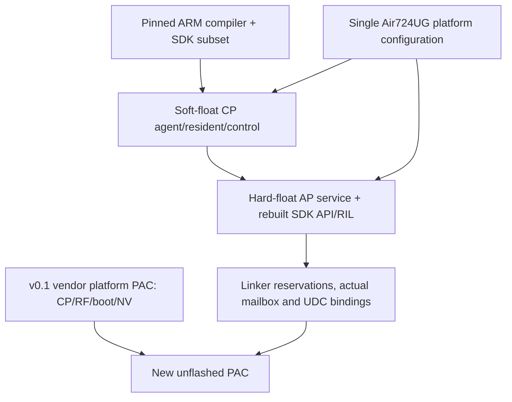

# Build v0.1 / 构建说明

The current release is **v0.1**, CP generation `0x526f0501`. Historical project
firmware releases have been retired. The release PAC is a byte-identical relabel
of the previously tested firmware; runtime identity/ABI are unchanged.

The Windows recipe compiles CP agent/resident/control, SDK API/RIL and AP service,
then packages a PAC. It uses the bundled pinned ARM compiler/SDK subset and the
v0.1 PAC as the vendor platform container. Vendor CP/RF/boot/NV remain binary
dependencies; this is not an all-open-source modem rebuild.

## Windows firmware build

From the repository root, including a downloaded ZIP in a different directory:

```powershell
python -m pip install -r requirements/build.txt
python -B tools/build_firmware.py
```

Default output: `work/build-v0.1/Air724UG_SDR_v0.1.pac`, `build.json`, `ap.elf`,
`ap.map`, generated bindings, CP artifacts and a build log. Use a new directory
for a subsequent build:

```powershell
python -B tools/build_firmware.py --output-dir work/build-check
```

Requirements: Windows x64, Python3.10+ (`pyelftools==0.33`). No SDK installation,
CMake, Ninja, WSL, historical test report, original drive letter or hardware is
required. Network is needed only for the Python package if not already installed.
`python -B tools/prepare_build.py --check` checks inputs without extracting.
See [build input inventory and provenance](../build-support/README.md).

The build never flashes a device or changes `current/manifest.json`. Outputs are
marked `built_not_flashed`. Current shared RF profile sources include later host
Auto changes, so a fresh build need not be byte-identical to the deployed v0.1
PAC. `byte_identical_to_release` and individual payload hashes report the result.
A newly linked binary does not inherit historical hardware acceptance merely
because its generation or release version matches.

The platform PAC binds six UDC function prefixes to verified addresses. Packaging
checks those bytes, uImage/PAC integrity, AP hooks, actual mailbox, resident size
and unchanged vendor payloads. Application CRC/header/ACK remains absent from IQ;
container CRC and source hashes are separate.

## Rebuilt and retained components



The RF observer and previously reconstructed RF runtime remain in the platform
container. Full reconstruction from stock vendor images is outside this recipe.
Historical observer/experimental builders are research tools; their removed
historical dependencies are not required for the current build.

`outputs/firmware/v0.1/linked/` retains the deployed AP ELF and CP modules for local
audit; the independent source export does not need them. `source-snapshot/`
records the exact originally linked sources. Final measurements retain original
vNN labels for traceability; these are not additional available release versions.

Resident code is15,572 B in16 KiB, control2852 B in the retained release. This is
code reservation, not total chip RAM/flash. Review DMA access and linked memory
before increasing rings/code; the build enforces the current reservations.

## Host library and optional SDR adapters

The [WSL host build guide](building-wsl.md) lists the Ubuntu packages, offline
cache requirements, runtime DLLs and Windows checks. Local MinGW/Soapy/MSVC/
Windows SDK toolchains remain preserved. From a clone or source ZIP in WSL:

```bash
sudo apt-get update
sudo apt-get install --no-install-recommends \
  python3 cmake ninja-build ca-certificates \
  gcc-mingw-w64-x86-64-posix g++-mingw-w64-x86-64-posix \
  binutils-mingw-w64-x86-64
python3 -B tools/build_host_components.py --toolchain-root /usr
```

This builds paired Windows x64 DLL/receive CLI, timing CLI and Soapy module in
`outputs/host/build-v0.1/`. It checks PE architecture and non-system DLL import
closure. The pinned Soapy0.8.1 source archive is included in `build-support/`;
no historical RF report, Git fetch or prebuilt Soapy SDK is needed. The installed
Ubuntu packages supply compiler Linux runtime dependencies; these are not all
inside the seven-package optional offline MinGW cache.

For a receive-only candidate, add `--without-soapy`. Manual component builders
also accept `--toolchain-root`; select new directories and pair their paths
explicitly. Never overwrite active releases during a build check.

For SDR++, arrange the pinned source/compiler/core described in
[host/sdrpp/README.md](../host/sdrpp/README.md), then in Windows PowerShell:

```powershell
python -B tools/build_sdrpp.py --sdrpp-root D:\Tools\sdrpp_windows_x64 --host-dir outputs/host/build-v0.1/windows --output-dir outputs/host/sdrpp-candidate --build-dir work/sdrpp-candidate
```

Full automatic MSVC/SDR++ bootstrap is not claimed. The portable core's C++ ABI
must match. A firmware build pass is not a Windows/Soapy/SDR++ build or hardware
pass. Current paired host binaries remain identified in the
[host manifest](../outputs/host/manifest.json).

## Validation

```powershell
python -B tools/check_publication.py
python -B tools/generate_report_assets.py --check
python -B tools/prepare_build.py --check
python -B tools/usb/prepare_soapy_sdk.py --check-source
python -B tools/sdr.py verify
```

`sdr.py verify` checks the retained workstation's identities, links and historical
evidence freshness. It requires local research inputs omitted from an export; it
is not the portable build gate. Portable CI checks tables/docs and archives,
builds firmware on Windows, cross-builds host components on Ubuntu24.04 and
tests the resulting Soapy/queue binaries on Windows. Independent-copy evidence
is recorded in [v0.1 consolidation](../records/maintenance/release-v0.1-README.md) and
[WSL host build validation](../records/maintenance/host-build-wsl-README.md).
A configured GitHub workflow is not evidence that it has already run.

Original IQ/capture logs were deleted at the owner's request. Final tables can
be regenerated; historical RF spectra cannot be replayed. Stale historical source
fingerprints remain disclosed, not silently promoted to current passes.
