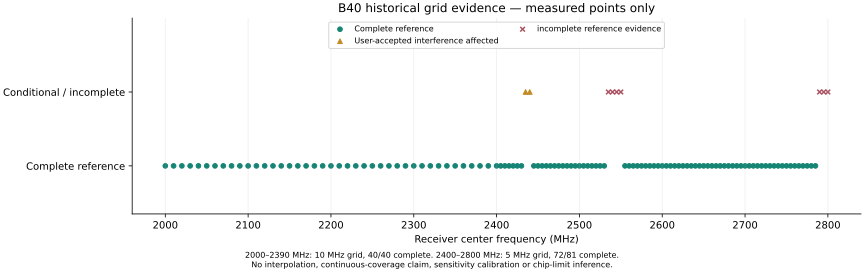

# UIS8910DM SDR conversion: technical and performance report

Snapshot: 2026-10-30. Target: Air724UG, UIS8910DM LTE Cat.1 module. [中文报告](technical-report.md).

This report separates deployed functionality, historical measurements, reconstructed software behavior and unresolved hardware questions. It introduces no new hardware measurements. Current release pointers are the [firmware manifest](../outputs/firmware/current/manifest.json) and [host manifest](../outputs/host/manifest.json). Release v0.1 preserves the recorded v32 firmware bytes / CP generation `0x526f0501`; it is not a live connection claim.

## 1. Result and scope

The module can deliver pre-demodulation complex receive samples over USB, with Windows CLI/library, SoapySDR and SDR++ consumers. Receive operation does not require a SIM or network registration. Normal frequency/gain/BW changes use STOP, drain, configuration and restart, without resetting the chip. Over-air ten-second QPSK/OFDM tests demonstrate real-time host decoding at selected frequencies and BW0/BW1.

The conversion retains vendor boot, RF initialization and board calibration. It does not replace the entire modem firmware or expose the ADC directly. It is a single-channel RX research device, not an SDR transmitter or a calibrated receiver. A fully independent open-source cold-start implementation, continuous tuning specification and silicon physical limits have not been established.

## 2. Engineering method

### 2.1 Reuse known initialization; intercept before demodulation

Early work established debug monitoring and RAM-loaded control. SDK binary analysis then identified the receive request, RF preparation, RXCAPT and completion paths. Retaining these vendor dependencies avoided inventing calibration data or relying on successful LTE attachment. Later dedicated service firmware integrated the AP USB path with CP resident capture modules.

The current runtime follows:

`configuration → NV/calibration selection → RF coefficient preparation → A/B RXON → digital RX preparation → RXCAPT DMA → DDR ownership → UDC DMA → host`

“Digital RX” may include filtering and decimation. The current raw RX_PRE setup clears FIR_EN bit6; this does not show that every upstream digital/analog filter is bypassed. Calling the output “ADC raw” or claiming all FIR stages are enabled would be unsupported.

### 2.2 Use disassembly to answer a specific implementation question

The primary behavioral authority is the local UIS8910 SDK binary. Pinned ZW217 source supplies same-generation names, layouts and RFFE routines. Small RDA8955/8810/8850e excerpts help identify predecessor design patterns, but their register positions are not portable to UIS8910.

`firmware/rf_rebuild/` contains executable C comparisons of frequency arithmetic, mode handling, RXON fragments, RFAD and NV helpers. Offline native/emulated comparisons validate software outputs and access sequences. They do not prove silicon lock, analog topology or full replacement of vendor startup. The RF instruction image includes legacy PULP extensions, so generic RISC-V disassembly alone can misdecode instructions.

The [register crosswalk](../records/rf/reference-rf-register-crosswalk.json) maps 129 entries, 51 named declarations and 172 compiled reference bitfield values per address view. Two address views were compiled. These counts are reference coverage, not the number of independently validated silicon registers.

### 2.3 Reject ambiguous RF successes

The useful reference test combines TX-off comparison, identifiable tones and an RX center-frequency change. A reference peak should move with the requested center offset; ambient Wi-Fi/Bluetooth energy or a static spur is insufficient. Grid points are recorded individually rather than interpolated into an asserted continuous tuning range. Antenna, route, RX gain, TX gain and digital amplitude belong to each result.

## 3. Architecture and implementation

The [architecture document](architecture.md) provides dataflow, ownership and retune diagrams. AP code handles the USB service; CP code schedules capture and RF requests; RF firmware executes local register transactions. The exact RF external frontend and board wiring remain unknown.

Six 8192-byte output slots hold 49,152 bytes. RXCAPT DMA writes DDR and UDC DMA reads that same buffer, avoiding a device CPU payload copy between capture and USB. The software still checks ownership, cache visibility, lengths, completion and errors. Paired scratch permits excess acquisition to be discarded when output cannot keep up. A confirmed completion/release is required before reuse.

Windows normally posts 32 × 64 KiB async reads. File output and plugins use bounded queues; these host paths copy payloads and/or convert samples. Device direct DMA is not an end-to-end zero-copy claim. No measured device CPU utilization percentage is available; architectural copy reduction and host CPU measurements should not be substituted for that missing metric.

Current scheduling uses 250 µs for BW0/BW1 and 100 µs for BW2–BW5. Repeated scheduler/ACK timing experiments showed insufficient benefit to continue. The approximately 30–32 MB/s practical baseline is an engineering result, not a proven USB controller physical ceiling.

STOP keeps outstanding reads active while the device drains. Only after buffer ownership is resolved may configuration and restart proceed. SDR++ merges rapid retune requests with a 120 ms settling interval and a serialized worker. The user confirmed the former rapid-retune freeze was resolved. Neither RF lock time nor a seamless switching interval is specified.

## 4. Sample format and interpretation

| Property | Definition |
| --- | --- |
| Raw ordering | lane0, lane1, lane0, lane1… |
| Storage | each lane is little-endian int16; 4 B/complex sample |
| Native value | signed12 in container bits15:4; arithmetic `int16 >> 4` |
| Host CF32 convention | `(lane0-j*lane1)/2048` after native12 decoding |
| Physical I/Q labels | unconfirmed; host frequency orientation was checked |
| ENOB / ADC bit depth | not established by the container format |

The IQ data plane has no application header, CRC, payload hash, ACK or retransmission. USB's own link checks still apply; separate COM control retains its framing/checks. Control and reports carry metadata outside the payload.

Raw files have no embedded rate, tuning history, sequence or timestamps. Byte alignment reconstructs sample pairs but cannot locate gaps. Device-completed, host-received, file/consumer-delivered, queue-discarded and drain-tail bytes are separate counters. Byte equality at two layers does not establish gap-free capture upstream.

## 5. Frequency coverage

### 5.1 User-facing interpretation

The research envelopes can be summarized as approximately **687.5–1000 MHz** and **1375–2786 MHz**, subject to discrete/grid evidence. They are not guaranteed continuous bands. In particular, **1000 MHz is a software envelope**, not a passed upper-edge reference: 970/985 MHz references passed; 990 MHz was condition-dependent; 995 and 999.9 MHz did not qualify. The 1.0–1.375 GHz gap is unproven.

Center frequency is independent of the internal LTE calibration route. Auto hides route selection from SDR applications. Choosing a route remains meaningful when overlapping routes differ in frontend attenuation, calibration validity or reference quality. Users should not need to select B3/B5/B8/B40 themselves.

### 5.2 Historical reference evidence

| Region / points | Evidence and limitation |
| --- | --- |
| 687.5 MHz | [B5 reference success](../records/rf/lowband-b5-6875-v21-reference.json); nearby 681.25 MHz failed to identify the first tone under those conditions |
| 970 / 985 MHz | [970](../records/rf/lowband-b8-970.json), [985](../records/rf/lowband-b8-985.json) complete references |
| 990 / 995 / 999.9 MHz | [990 stronger-reference success](../records/rf/lowband-b8-990-gain50.json); [ordinary 990 failure](../records/rf/lowband-b8-990.json); [995](../records/rf/lowband-b8-995-gain50.json), [999.9](../records/rf/lowband-b8-9999-gain50.json) unqualified |
| 1375–1710 MHz representatives | [B3 extension](../records/rf/coverage-v32-b3-lower-summary.json): 1375/1400/1447/1500/1600 and earlier 1650/1680/1710 references; 1350/1300 failed in the recorded setup |
| 2000–2390 MHz, 10 MHz grid | [40/40 complete references](../records/rf/coverage-b40-grid-2000-2390-summary.json); narrow holes between points are not excluded |
| 2400–2800 MHz, 5 MHz grid | [72/81 complete](../records/rf/coverage-b40-grid-2400-2800-summary.json); 2435/2440 accepted by user as environment affected; other incomplete results retained |
| Upper refinement | 2786 MHz complete; 2787–2789 MHz tracking with degraded prominence; 2800 MHz weak/incorrect tracking, not qualified |

At 2535/2545 MHz the off/on checks are incomplete; 2540/2550 MHz have single-tone partial evidence. These have not silently been promoted to complete references. The grid figure is categorical, with no interpolated coverage line.



### 5.3 Limits of physical interpretation

Experiments used B210 with physical TRX1 mapped to `A:A A:B / channel0 / TX-RX`, existing 2.4/5 GHz Wi-Fi antennas, varying gain and approximately 25–50 cm separation depending on the record. This is not a calibrated RF fixture. Low-frequency antenna loss, frontend filters, analog routing, PLL/divider behavior, interference and reference quality can all affect results. Non-detection does not prove chip non-support. No physical tuning limit has been isolated.

There is also a known host policy discrepancy: C++ Soapy/SDR++ helpers cap B40 Auto at 2786 MHz, whereas the Windows C helper can request up to 2790.625 MHz. This documentation task does not change tested release binaries. See the [maintainer review](maintainer-review.md).

## 6. Bandwidth, rate and USB

| BW | Nominal Msps | Full raw MB/s | Historical relative −3 dB total width, MHz | Practical use |
| --- | ---: | ---: | --- | --- |
| 0 | 1.92 | 7.68 | 1.05–1.10, B5 | raw budget sustainable; exact gap-free capture unknown |
| 1 | 3.84 | 15.36 | 2.75–2.80, B5 | raw budget sustainable; consumer performance still matters |
| 2 | 7.68 | 30.72 | 4.55–4.65, B5 | borderline supply; not in current communication acceptance |
| 3 | 15.36 | 61.44 | 9.2–9.4, B5 | partial output / spectrum |
| 4 | 30.72 | 122.88 | 13.6–13.8, B5 | partial output / spectrum |
| 5 | 30.72 | 122.88 | 17.5–18.5, B40 | partial output / spectrum |

MB/s is decimal; sample rates are nominal complex rates. These widths are sparse **end-to-end relative response brackets**, measured with a fixed RF tone and varying RX center, normalized to a reference and checked for repeat drift. They include tuning/calibration, analog and digital response; they are not calibrated isolated-filter specifications. BW0–BW4 used B5 around an 881.65 MHz RF tone; BW5 used B40 at 2000.15 MHz. RX index40 and TX setting20 (BW0/1) or40 (BW2–5) were historical conditions, not current default settings.

The [performance page](performance.md) links each measurement. The vendor's nominal LTE1.4/3/5/10/15/20 MHz bandwidth labels do not equal sampled complex rate or this relative −3 dB definition. BW4/BW5 share 30.72 Msps but have distinct measured responses. BW6/7 showed no additional passband evidence and were closed.

Historical v29 B8/880 MHz device rates were approximately 7.680,15.360,30.35 MB/s over10 s for BW0–2, and31.55,31.60,31.94 MB/s over3 s for BW3–5. At BW5,31.94 MB/s is only about26% of the122.88 MB/s native raw budget; it cannot imply a continuous7.985 Msps replacement stream at the same analog bandwidth. Samples arrive in retained segments with unknown missing intervals. Wide FFT windows crossing gaps may have artifacts; the nominal frequency axis alone cannot validate a communication waveform.

## 7. Ten-second real-time over-air demonstrations

The [final acceptance record](../records/communication/functional-acceptance.json) records B210 finite transmissions, RX index30, TX gain setting65 (not calibrated dBm), approximately50 cm and Wi-Fi antennas. Source amplitudes differ by waveform. TX and receiver processes exited, and the device drained.

| MHz | BW | Modulation | Frames | BER on decoded bits | RMS EVM | Host pipe drop | Source-file frame yield |
| ---: | ---: | --- | ---: | ---: | ---: | ---: | ---: |
| 2700 | 0 | QPSK | 2022 | 0 | 4.6846% | 0 B | 99.7533% |
| 1900 | 0 | OFDM | 4157 | 0 | 3.1530% | 0 B | 99.7840% |
| 1900 | 1 | OFDM | 8320 | 1.5593e−5 | 3.0440% | 0 B | 99.8440% |
| 1900 | 1 | QPSK | 2866 | 0 | 10.3425% | 59,179,008 B | 70.6956% |

QPSK BW1 proves wireless payload recovery with loss; clean real-time acceptance remains false. BER is conditional on decoded/validated data, not all emitted bits. Frame yield uses complete frames in the source file, not a measured count of physically transmitted RF frames. The over-air frame sequence/PRBS belongs to the test waveform and is not a USB application header.

Device-minus-host differences were24,576/57,344/49,152/49,152 B respectively. Demodulator CPU time was4.297/7.109/6.547/14.438 s; native receiver CPU time0.094/0.109/0.125/0.516 s. Receiver wall time was approximately14.8–15.1 s including startup/tail, distinct from the10 s source duration. CPU seconds are not normalized utilization and should not be added blindly across overlapping counters.

Sampled native12 lane peaks26/110/109/68 showed no near-rail events in the sampled blocks. This does not exclude analog compression or unsampled clipping. Prior failed communication at1000/2600/2786 MHz and lowband OFDM remains failed/unknown; a reference-tone success is a different test.

## 8. Registers and RF reconstruction

The [register reference](register-reference.md) distinguishes RF-local MMIO, CP aliases, a GGE reference view, RF runtime RAM, CP RFAD and external RFFE transactions. The generated [register CSV](data/rf-registers.csv) and [field CSV](data/rf-fields.csv) preserve scope and source mentions.

Frequency helper `0x37f0` accepts100 Hz units and writes coefficients to RF RAM. Below1 GHz its arithmetic input is doubled. With divisor factor D, the reconstructed operations include:

```text
effective_raw = working_raw * 2  if working_raw < 10,000,000 else working_raw
Q8 = floor(effective_raw * 256 / 260,000)
W  = floor(effective_raw * 2^28 / (260,000 * D)) mod 2^32
```

Default D is7 unless the relevant NV enable is exactly1. D=7 arithmetic rollover at effective2912 MHz is a numeric encoding boundary, not a measured RF limit. Later RXON paths consume these coefficients; `0x37f0` alone does not write the hardware PLL. `rxpll_cal_ready`, static VCO code and BBPLL lock must not be relabeled as RF LO lock. The physical divider topology remains unresolved.

## 9. External frontend findings

The EC200U investigation suggested RPM6743-31/RTM7916-51 possibilities. Air724UG does not inherit another module's bill of materials by assumption. UIS8910 NV, pinned ZW217 source and native execution support a RTM7916-51-compatible initialization hypothesis and a selector/NV/RFFE command chain. No reliable physical ID/BOM evidence uniquely identifies the exact part suffix or board wiring.

B3/B5/B8 use different slave13 switch values; B40 has an additional slave15 path. A finite B5 switch comparison at900 MHz found about−0.09 dB change, no useful gain. B8 comparisons were unstable/inconclusive. Default Auto was therefore not changed by this hypothesis. A stored expected ID constant or zero-on-timeout result is not a physical chip ID. See the [assessment](topics/rf/investigations/zw217-reference-assessment.md).

## 10. Reproduction, retention and remaining gaps

Release v0.1 preserves the tested firmware bytes. Pinned ARM/SDK subset archives and the v0.1 vendor platform PAC are included in the local buildable source review package. `tools/build_firmware.py` compiles AP/CP and packages a PAC from an independent directory, without the original SDK checkout or historical work outputs. Vendor CP/RF/boot/NV remain binary dependencies; newly built output is unflashed. `tools/build_capture.py` is an older B5 research baseline. See [building](building.md) for the actual dependency graph and safe candidate commands.

At the owner's request, original IQ payloads and generated waveform/conversion intermediates in `records/` and `work/` were deleted after final metrics were retained. Original numerical reports remain, but raw reanalysis of those runs now requires new acquisition. This lowers storage cost and limits reproducibility; it is explicitly recorded in the [cleanup audit](../records/maintenance/open-source-preparation-README.md). Frozen historical archives were not traversed for deletion.

Unmeasured properties remain unclaimed: calibrated sensitivity/noise figure/linearity, ENOB, actual RF LO lock, physical continuous limits, exact frontend BOM, calibrated clocks, absolute timestamps, exact lost samples and hardware-wide CPU utilization. Licensing of the buildable package, contributor workflow and Auto boundary consistency remain tracked in the [maintainer review](maintainer-review.md). Reproducing the Windows firmware build does not establish those hardware properties.
